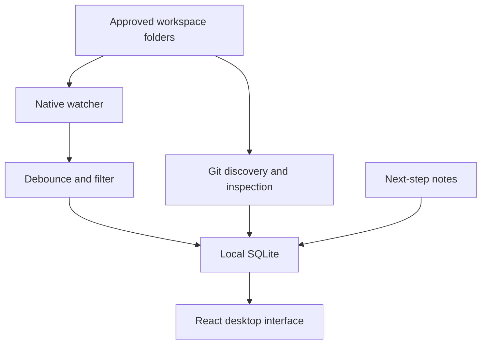

# Tokly

Desktop version 0.2.0 adds Continue Working cards with persistent pins and selectable Git history.

**Pick up where you left off.** Tokly is a local-first desktop companion that discovers Git projects inside workspace folders you choose, records file activity, and keeps your next step close.

This rebuild replaces the previous AI usage platform. No server, login, API billing, token telemetry, or cloud database is required. Version 1 targets macOS 12+; Windows and Linux are planned for version 2.

## Run on a Mac

Install Node.js 22+, the current stable Rust toolchain, and Xcode Command Line Tools (`xcode-select --install`). Then:

```sh
npm ci
npm run desktop
```

Choose a parent workspace such as `~/Projects`. Tokly discovers repositories up to 12 directory levels deep, including Git worktrees. Continue working in any editor or agent; Tokly observes file changes without needing projects opened in its own window. Closing the window leaves tracking in the menu bar. Choose **Quit Tokly** to exit. Launch at login is opt-in in Settings.

Choose **Preferred editor** in Settings. Tokly detects supported installed Mac apps through the system application registry: Visual Studio Code, Cursor, Zed, Xcode, Sublime Text 4, BBEdit, Nova, IntelliJ IDEA, WebStorm, PyCharm, and VS Code Insiders. Automatic uses the first installed choice in that order; Finder is the fallback when none are available. Your explicit choice persists across relaunches. If it is removed or fails to open, Tokly opens Finder and explains the fallback. Use **Refresh installed editors** after installing an editor; detection also refreshes when the window gains focus. **Open folder** always uses Finder. No editor plugin is required for filesystem tracking. Merely opening an editor or folder is not recorded as work; v1 cannot attribute changes to a particular editor, person, or agent.

## What works

- Native folder approval, automatic Git discovery, exclusions and restoring excluded projects.
- Debounced file activity with metadata stored in local SQLite.
- Branch, working-tree changes, recent commits, and disconnected-folder status.
- Continue working cards with saved next steps, branch, working-tree status and direct editor access.
- Pin projects to keep them first; pins and next-step notes persist locally.
- Overview, project Activity / Changes / Notes, weekly progress, and Settings.
- Automatic monitoring after folder approval, menu bar access, close-to-background, and opt-in login startup.
- Configurable 7 / 30 / 90 / 365-day activity retention.
- Midnight + Lilac interface with peach notes, mint status, keyboard focus and reduced-motion support.

## Privacy and limits

Only approved parent folders are scanned; directory symlinks are not followed. Dependencies, caches and build folders are skipped. Git-ignored files are omitted from file-event records. SQLite lives in the app's macOS Application Support directory under identifier `com.blackielabs.tokly`; it stores paths, timestamps, branch names, filenames, commit summaries/SHAs, notes and settings, never source contents or diffs. There are no network integrations or AI calls.

Git history defaults to seven days; choose 7, 30 or 90 days in a project’s Activity tab to import and display commits reachable from the current branch, from all authors. The shorter of history and retention applies; these are repository activity, not a measure of your personal productivity. Imported commits are deduplicated by repository and SHA and then retained for your selected duration. History follows the currently checked-out branch when scanning; previously collected commits remain until retention expires. A scan is capped at 10,000 commits. Older branch tips are identified explicitly so an empty history does not imply a missing repository. Reducing the history window hides older commits without deleting them; retention controls deletion. File activity shown in the interface and weekly chart is limited to the latest 500 retained file events. Neither edit counts nor commits represent completed tasks or hours worked.

The watcher batches saves with a two-second quiet period. It reconciles discovery and Git state every minute and after observed changes. On wake, reconciliation resumes; after downtime, current Git state can be recovered but missing edit events cannot. A bounded notification queue protects memory; overflow can lose edit history but the next scan repairs current Git state. Workspace scanning currently holds the database lock, so very large workspaces may delay snapshots. Keep roots focused on development workspaces. Monitoring starts automatically for approved folders whenever Tokly runs, including after relaunch. Quit Tokly to stop monitoring; launch at login remains opt-in. Exclusion stops future collection but keeps existing records and notes locally; removing the last approving workspace deletes the affected project records and notes.

## Browser preview

```sh
npm ci
npm run dev
```

Open `http://localhost:1420`, then **Explore a sample workspace**. The preview uses synthetic data in browser localStorage; it cannot access local folders, run Git, open Cursor or enable login startup. Notes and preferences work within that sample. **Reset sample workspace** clears it. Real tracking is only available in the native application.

## Build and verify

```sh
npm run build
npm test
npm run test:e2e
cargo test --manifest-path crates/tracker/Cargo.toml --locked
cargo clippy --manifest-path crates/tracker/Cargo.toml --all-targets -- -D warnings
# On macOS:
npm run tauri -- build --bundles app --no-sign
```

Install the browser once with `npx playwright install chromium`. CI builds unsigned macOS app bundles for Apple Silicon and Intel and uploads them as workflow artifacts. The app is zipped with macOS metadata to preserve executable permissions. These are developer test builds, not notarized releases. Signing/notarization requires the owner's Apple Developer identity and credentials, not included in this repository. macOS folder permissions, Finder/Cursor opening, login startup, menu bar behavior, and sleep/wake recovery need real-Mac acceptance testing before shipping.

## Architecture



- `crates/tracker`: platform-neutral tracking engine, persistence and tests.
- `src-tauri`: native commands, folder chooser, menu bar and lifecycle.
- `src`: desktop UI plus an explicitly separated browser sample adapter.
- `.github/workflows/ci.yml`: interface tests and macOS build matrix.
